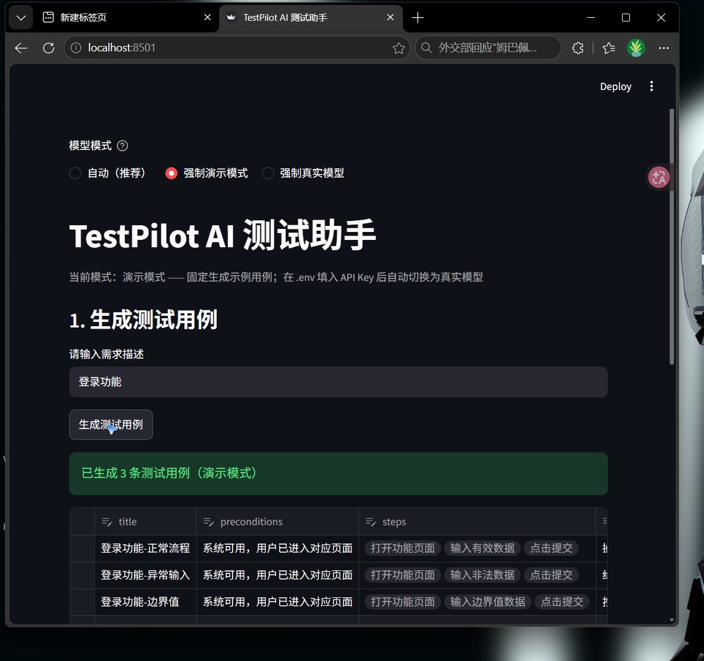
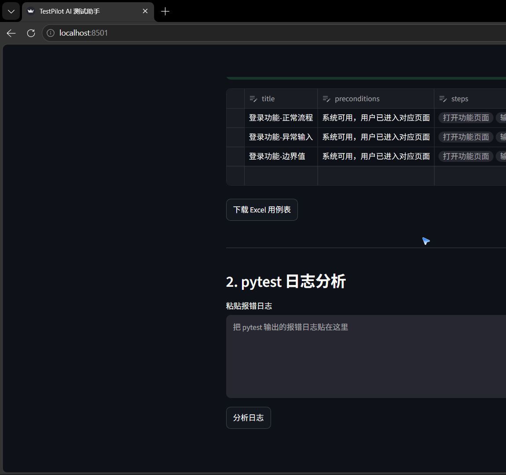
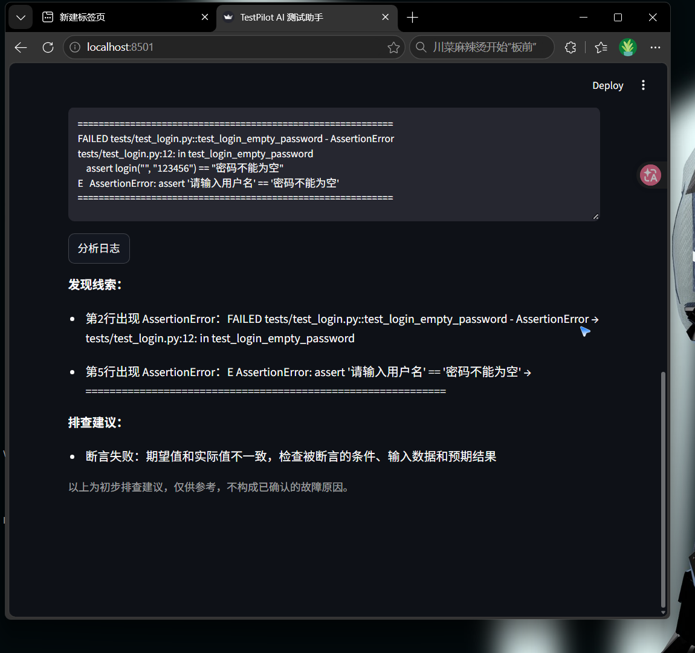

# TestPilot AI — AI 软件测试助手

输入一段功能需求，自动生成结构化测试用例；支持表格编辑、Excel 导出、pytest 日志分析，并可接入真实大模型（阿里云百炼）生成用例。

面向"全国大学生软件测试大赛"训练 / 求职作品集项目。**演示模式不依赖真实大模型，可离线运行；配置 API Key 后自动切换为真实模型**。

---

## 1. 项目背景与解决的问题

软件测试人员（尤其是刚入门的学生）经常面临三个痛点：

| 痛点 | 本项目如何解决 |
|------|---------------|
| 写测试用例费时，且容易漏掉异常和边界场景 | 输入一段需求，自动生成"正常 / 异常 / 边界"三类用例 |
| 生成的用例质量参差不齐、格式不统一 | 统一 6 字段结构，并由程序校验字段是否齐全、类型是否合理 |
| pytest 报错日志看不懂、不知道从哪排查 | 粘贴日志，自动提取报错关键词并给出初步排查建议 |

除此之外，本项目把**真实大模型接入**做成了"可插拔"能力：

- 不配置 API Key → 自动进入演示模式，离线可用，零成本；
- 配置 API Key → 自动切换为真实模型，由大模型生成贴合需求的用例；
- 模型输出经过 **JSON 解析 + 6 字段校验**，不合格自动让模型重写（有限次数），不会把脏数据当结果。

## 2. 核心功能与主要页面截图

| 功能 | 说明 |
|------|------|
| 自动生成测试用例（演示模式） | 输入需求（如"登录功能"），按固定模板生成 3 条用例：正常流程 / 异常输入 / 边界值 |
| 自动生成测试用例（真实模型） | 配置 API Key 后自动调用 qwen 系列模型生成用例；输出经 **JSON 解析 + 字段校验**，不合格自动让模型重写（有限次数） |
| 用例统一结构 | 每条用例含 6 个字段：标题、前置条件、步骤、预期结果、优先级、测试类型 |
| 表格内编辑 | 用例生成后直接在页面表格里修改（Streamlit `data_editor`） |
| 导出 Excel | 一键下载 `.xlsx`，可直接用 Excel / WPS 打开 |
| 日志分析 | 粘贴 pytest 报错日志，规则匹配提取关键词并给出**初步排查建议**（仅供参考，不下结论） |
| 日志落盘 + 自动切割 | 日志同时写进 `app.log`（只存 WARNING 及以上），写满 1MB 自动滚动，最多保留 3 个备份 |
| 双模式切换 | 页面提供"自动（推荐）/ 强制演示 / 强制真实"三种选择 |

### 2.1 主页面与用例生成（演示模式）

输入需求"登录功能"，点击生成，得到 3 条结构化用例（正常流程 / 异常输入 / 边界值），并支持在线编辑与导出 Excel：



### 2.2 用例编辑与 Excel 导出

表格可直接编辑，点"下载 Excel 用例表"导出 `.xlsx`（页面下方同时是 pytest 日志分析入口）：



### 2.3 pytest 日志分析

粘贴 pytest 报错日志，点击"分析日志"，自动定位报错行、提取关键词并给出排查建议：



> 以上截图来自本项目真实运行界面（演示模式）。

## 3. 技术栈及选型原因

| 技术 | 用途 | 为什么选它 |
|------|------|-----------|
| Python 3 | 开发语言 | 测试领域生态最丰富，语法简单，适合学习和快速迭代 |
| Streamlit | Web 页面 | 纯 Python 写界面、无需前端代码，几十行即可完成交互页面（输入、按钮、表格、下载），适合工具型应用 |
| pandas | 表格数据 | 把用例列表转成 DataFrame，直接对接 `data_editor` 在线编辑和 Excel 导出 |
| openpyxl | Excel 导出 | 生成 `.xlsx` 文件的标准库，Excel / WPS 均可打开 |
| requests | 调用大模型 | 阿里云百炼提供 OpenAI 兼容 HTTP 接口，requests 直接 POST 即可 |
| python-dotenv | 密钥管理 | 从 `.env` 读取 API Key，避免密钥硬编码进代码；`.env` 已被 `.gitignore` 忽略 |
| pytest | 单元测试 | Python 标准测试框架；本项目大量使用 `monkeypatch` 模拟网络请求、`caplog` 校验日志 |

## 4. 项目目录说明

```
testpilot-ai/
├── app.py                   # Streamlit 页面（只负责展示和调用，不写业务规则）
├── core.py                  # 核心逻辑：demo_cases / validate_cases / parse_json /
│                            #           generate_cases / call_llm / generate_cases_with_llm /
│                            #           analyze_failure / has_valid_key / resolve_mode
├── logging_config.py        # 日志配置：控制台 + 文件双通道，RotatingFileHandler 自动切割
├── requirements.txt         # 依赖清单
├── .env.example             # 环境变量样例（含字段说明，不放真实密钥）
├── .gitignore               # 忽略 .venv / .env / 缓存 / *.log 等
├── README.md                # 本文件
├── scripts/                 # 一次性历史脚本（Day 8 / Day 12 评估用，归档保留）
│   ├── api_test.py          # Day 8：阿里百炼 API 直连验证脚本
│   ├── eval_run.py          # Day 12：批量跑 20 条需求评估集
│   └── eval_rerun.py        # Day 12：改进提示词后重跑样本对比
├── docs/
│   ├── demo-script.md       # 3 分钟演示脚本（Day 19）
│   └── screenshots/         # README 使用的运行截图
├── tests/
│   ├── test_core.py         # 核心逻辑测试（35 个）
│   ├── test_llm_robustness.py  # 异常与边界测试（32 个）
│   └── test_logging_config.py  # 日志落盘与切割测试（6 个）
└── reports/
    ├── evaluation-plan.md   # 20 条需求评估集 + 5 维度评估标准
    ├── evaluation.md        # 评估总结
    ├── eval_outputs.md      # 20 条需求原始输出记录
    └── eval_outputs_v2.md   # 提示词改进后重跑样本对比
```

> `.venv/`、`__pycache__/`、`.pytest_cache/` 为环境与缓存目录，已由 `.gitignore` 忽略。

## 5. Windows 环境安装步骤

前提：已安装 Python 3.10 及以上版本（安装时勾选 **Add Python to PATH**）。

```powershell
# 1. 进入项目目录
cd testpilot-ai

# 2. 创建并激活虚拟环境
python -m venv .venv
.venv\Scripts\activate        # 激活后命令行前缀会出现 (.venv)

# 3. 安装依赖
pip install -r requirements.txt

# 4. 启动页面
streamlit run app.py

# 5. 浏览器打开 http://localhost:8501
```

## 6. 演示模式运行步骤

演示模式**不需要任何配置**，适合离线体验全部功能：

1. 按第 5 节完成安装并启动，浏览器打开 `http://localhost:8501`；
2. 页面顶部**模型模式**保持默认的"自动（推荐）"——因为没配 API Key，会显示 **"当前模式：演示模式"**；
3. 在"请输入需求描述"里输入，例如 `登录功能`，点击**生成测试用例**；
4. 得到 3 条用例（正常流程 / 异常输入 / 边界值），可直接在表格中修改；
5. 点击**下载 Excel 用例表**导出 `.xlsx`；
6. 下方"pytest 日志分析"粘贴一段报错日志，点击**分析日志**，查看线索与排查建议。

## 7. 真实模型 API 配置步骤

> 演示模式能跑通之后再接入真实模型，避免配置问题与功能问题混在一起。

1. 复制环境变量样例为 `.env`：

```powershell
Copy-Item .env.example .env
```

2. 编辑 `.env`，填入真实值：

| 字段 | 说明 |
|------|------|
| `DASHSCOPE_API_KEY` | 阿里云百炼 API Key（`sk-` 开头）。获取：登录百炼控制台 → API-KEY 管理 → 创建 |
| `DASHSCOPE_BASE_URL` | API 根地址。通用地址（推荐，无需业务空间 ID）：`https://dashscope.aliyuncs.com/compatible-mode/v1` |
| `DASHSCOPE_MODEL` | 模型名称：`qwen-turbo`（最便宜）/ `qwen-plus`（更聪明） |

3. 重启页面（`streamlit run app.py`），页面顶部将显示 **"当前模式：真实模型"**；
4. 生成用例时改为真实调用大模型，结果经解析、校验，不合格自动重写（默认最多重试 2 次）。

**安全约定**：`.env` 已被 `.gitignore` 忽略，绝不会被 git 提交；页面和错误提示均不回显 Key（有专门测试把关，见第 8 节）。

## 8. 测试命令与实际测试结果

在项目根目录（虚拟环境已激活）运行：

```powershell
python -m pytest tests -q
```

**当前实际测试结果（2026-10-29 验证）：**

```text
73 passed
```

> 通过数稳定为 73；耗时约 1 秒，随机器性能浮动。

| 测试文件 | 数量 | 覆盖内容 |
|---------|------|---------|
| `tests/test_core.py` | 35 个 | 演示用例生成、6 字段校验、JSON 解析、生成流水线、日志分析、双模式解析、Key 判断 |
| `tests/test_llm_robustness.py` | 32 个 | 异常与边界：超时 / 网络错误 / 401 / 429 / 5xx / 未知状态码、空内容、非法 JSON、超长需求、Key 不泄露、重试机制、日志分级 |
| `tests/test_logging_config.py` | 6 个 | 日志落盘：双通道、文件生成、分级过滤（INFO 不进文件）、切割滚动、备份数限制、重复调用幂等 |

测试默认**不发起真实网络请求**（全部用 `monkeypatch` 模拟），不消耗 API 费用；部分测试用 `caplog` 校验日志内容与级别。

## 9. 当前限制与后续计划

### 当前限制

- **演示数据 ≠ 真实结果**：演示模式是固定模板，页面会明确标识，不会冒充真实 AI 输出。
- **真实模型消耗费用**：评估和日常使用会消耗 API 额度，建议少量调用、记录输入输出避免重复消耗。
- **评估集是人工判断**：Day 11-12 的 5 维度评分是"AI 辅助判卷 + 人工复核"，不是自动化指标。
- **日志分析是规则匹配**：覆盖常见报错关键词（AssertionError / TypeError / ImportError 等 8 类）；复杂嵌套报错需人工补充 traceback 判断。
- **字段固定 6 个**：真实模型返回超出 6 字段约定会被校验打回，暂不支持用户自定义字段。

### 后续计划

| 优先级 | 计划 | 说明 |
|--------|------|------|
| 中 | 补充更多报错关键词 | 扩大日志分析规则表，覆盖更多常见异常 |
| 低 | 自定义用例字段 | 允许用户配置用例模板字段，突破固定 6 字段 |

> 已完成：日志落盘 + 自动切割 + 分级写入（Day 19，`logging_config.py`）。

## 开发记录

| 周 | 天 | 内容 | Git 提交 |
|----|----|------|----------|
| 第 1 周 | Day 1 | 环境搭建、项目骨架 | `72b4779` |
| | Day 2 | 演示用例生成 + 6 字段结构 + 校验 | `bc2d7d4` |
| | Day 3 | JSON 解析 + 生成流水线 | `e388ca6` |
| | Day 4 | Streamlit 页面 + Excel 导出 + 状态保持 | `ff75dc2` |
| | Day 5 | 规则型日志分析 | `ed3c084` |
| | Day 6 | 补齐单元测试（27 个全绿） | `d8ee276` |
| | Day 7 | 第一周验收：删无用代码、写 README | `aa7dc6a` |
| 第 2 周 | Day 8 | 阿里百炼 API 调用验证 | `6c9467a` |
| | Day 9 | 封装 call_llm + 接入真实模型 + 三层防线 | `579defc` |
| | Day 10 | 优化提示词 + 自动重试修正 | `c751c57` |
| | Day 11 | 20 条需求评估集 + 5 维度评估标准 | `b35ca28` |
| | Day 12 | 批量评估 20 条需求 + 改进提示词 + 重跑对比 | `5ca9105` |
| | Day 13 | 异常与边界测试（26 个）+ Key 不泄露防线 | `f11e10c` / `7f5c5c9` |
| | Day 14 | 第二周验收：验证双模式 + 更新 README | `09175f3` |
| 第 3 周 | Day 15 | 清理模块边界：模式逻辑收拢到 core | `728c921` |
| | Day 16 | 强化测试设计：has_valid_key / resolve_mode 补测 | `59ec058` |
| | Day 17 | 引入 logging 分级日志 + caplog 日志测试 | `62ce4ae` |
| | Day 18 | 完善 README 与使用文档 | `b67577d` |
| | Day 19 | 日志落盘 + 自动切割（logging_config + 6 测试）；整理演示脚本与截图 | `7f956f8` / `230b2fd` |

---

*第 1 周完成：页面可运行、演示用例可生成、Excel 可导出、常见日志可分析、27 个测试通过。*
*第 2 周完成：接入真实大模型、异常处理与 Key 保护、53 个测试通过、20 条需求评估集与评估记录。*
*第 3 周进行中：日志体系落盘（Day 17-19）、演示脚本（Day 19），当前 73 个测试全部通过。*
